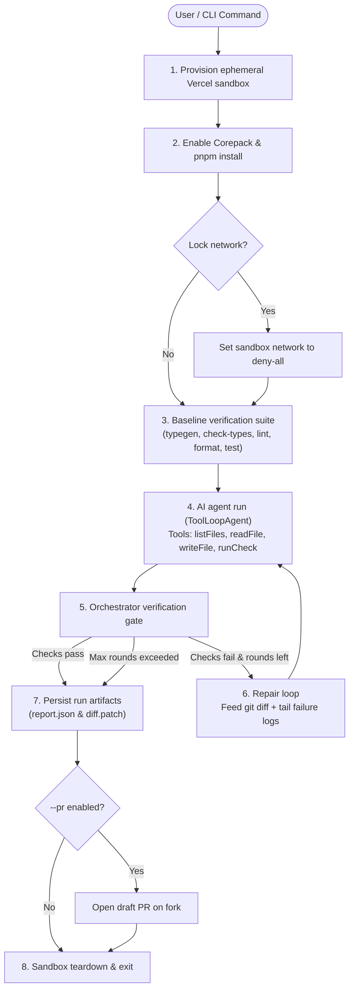

<div align="center">

# software-factory

Run AI coding agents inside disposable Vercel sandboxes with automated test verification and repair loops.

[](https://nodejs.org/)
[](https://www.typescriptlang.org/)
[](https://pnpm.io/)
[](https://www.docker.com/)
[](LICENSE)
[](https://aistudio.google.com/)
[](https://vercel.com/)

<p align="center">
  <a href="#key-features">Key features</a> •
  <a href="#architecture-and-workflow">Architecture and workflow</a> •
  <a href="#quick-start-with-docker">Docker quickstart</a> •
  <a href="#local-development">Local setup</a> •
  <a href="#cli-reference">CLI reference</a> •
  <a href="#environment-variables">Configuration</a> •
  <a href="#benchmark-suite">Benchmarking</a> •
  <a href="#contributing">Contributing</a>
</p>

</div>

## Overview

software-factory is a command-line tool that runs coding tasks in disposable virtual machines. For each task, it provisions an ephemeral Vercel sandbox, clones a target git repository, installs dependencies with pnpm, and runs baseline checks. It then assigns the task to a Google Gemini model equipped with repository-scoped file tools.

If verification checks fail after the agent edits files, an orchestrator gate passes the diff and failed check output back to the model for another attempt. Once checks pass or repair attempts run out, it saves a detailed report and patch file locally, and can optionally open a draft pull request on GitHub.

## Key features

- Disposable sandboxes: Every run gets its own temporary Vercel microVM, with optional network lockdown after pnpm install.
- Baseline drift detection: Runs five checks before the agent starts (typegen, check-types, lint, format, test). Any check that fails on a clean checkout is flagged as preexisting so it will not fail the run.
- File tools with path restrictions: The model can read, write, and list files, but cannot traverse outside the repository root or touch sensitive paths like .git, node_modules, .env*, package.json, or pnpm-lock.yaml.
- Automated repair loop: If post-edit checks fail, the runner feeds the error output and git diff --stat back to the model to fix its mistakes.
- Saved run artifacts: Saves report.json and diff.patch under ./runs/<timestamp> with token counts, CPU time, and round-by-round test status.
- Benchmark runner: Runs a batch of test tickets from bench/tickets.json sequentially and records the results in bench/results.md.
- Pull request creation: Pushes a branch and opens a draft pull request on your fork when all checks pass.
- Docker support: Multi-stage Dockerfile and Docker Compose setup that runs unprivileged as the node user and maps ./runs and ./bench to your local drive.

## Architecture and workflow



## Quick start with Docker

Docker is supported through a multi-stage Dockerfile and a docker-compose.yml file. Containers run as the unprivileged node user and mount ./runs and ./bench to preserve output on your host machine.

### 1. Clone the repository

```bash
git clone https://github.com/vrajrupareliya/software-factory.git
cd software-factory
```

### 2. Configure environment variables

Copy the example configuration to .env:

```bash
cp .env.example .env
```

Add your API keys and Vercel credentials to .env (do not wrap values in quotes):

```ini
VERCEL_TOKEN=your_vercel_personal_access_token
VERCEL_TEAM_ID=team_yourTeamId
VERCEL_PROJECT_ID=prj_yourProjectId
GOOGLE_GENERATIVE_AI_API_KEY=your_gemini_api_key
GEMINI_MODEL=gemini-3.5-flash-lite
```

> Note: For Docker and CI/CD, the Vercel token trio (VERCEL_TOKEN, VERCEL_TEAM_ID, VERCEL_PROJECT_ID) is required.

### 3. Run with Docker Compose (recommended)

Build the image:

```bash
docker compose build
```

Run a task:

```bash
docker compose run --rm factory "Add a testimonial document type with name, quote and author"
```

Artifacts (report.json and diff.patch) are written to your local `./runs/` folder.

Run with pull request creation:

```bash
docker compose run --rm factory "Add a testimonial document type with name, quote and author" --repo https://github.com/your-username/turbo-start-sanity --pr
```
Make sure `GITHUB_PR_TOKEN` is set in your `.env` file first.

Run the benchmark suite:

```bash
docker compose run --rm bench
```

Results are saved directly to `./bench/results.md`.

### 4. Run with Docker CLI

You can also run directly with the Docker CLI:

```bash
# Build the image
docker build -t software-factory .

# Run a task
docker run --rm -it \
  --env-file .env \
  -v "$(pwd)/runs:/app/runs" \
  software-factory "Add a testimonial document type with name, quote and author"

# Run the benchmark suite
docker run --rm -it \
  --env-file .env \
  -v "$(pwd)/runs:/app/runs" \
  -v "$(pwd)/bench:/app/bench" \
  --entrypoint node \
  software-factory dist/bench.js
```

## Local development

### Prerequisites

- Node.js v22.0.0 or higher
- pnpm v10.0.0 or higher (or run `corepack enable`)
- Git

### Installation

1. Install dependencies:
   ```bash
   pnpm install
   ```

2. Set up your environment file:
   ```bash
   cp .env.example .env
   ```
   If you use Vercel CLI locally, you can pull your project settings into `.env.local`:
   ```bash
   vercel link && vercel env pull .env.local
   ```

3. Run the TypeScript typecheck:
   ```bash
   pnpm typecheck
   ```

4. Run unit tests:
   ```bash
   pnpm test
   ```

5. Build the project:
   ```bash
   pnpm build
   ```

6. Run the CLI in development mode:
   ```bash
   pnpm dev "Add an author document type with name, avatar image, and bio"
   ```

## CLI reference

### Factory CLI (`pnpm dev` or `docker compose run --rm factory`)

```bash
pnpm dev "<task description>" [options]
```

| Flag | Type | Description |
| :--- | :--- | :--- |
| `<task description>` | `string` | Task instructions for the AI agent to carry out. |
| `--repo <url>` | `string` | Target repository git URL (defaults to `REPO_URL` or turbo-start-sanity). |
| `--ref <ref>` | `string` | Target git branch, commit, or tag (defaults to `main`). |
| `--max-rounds <n>` | `number` | Maximum repair attempts when checks fail (overrides `MAX_REPAIR_ROUNDS`, default: 3). |
| `--skip-baseline` | `boolean` | Skip the baseline checks on clean clone. |
| `--deny-network` | `boolean` | Lock sandbox network after dependencies install. |
| `--blind` | `boolean` | Removes the `runCheck` tool from the agent in round 0 and skips self-check prompts. |
| `--inject-fault` | `boolean` | Inserts a syntax error before the verification gate to test the repair loop. |
| `--pr` | `boolean` | Opens a draft pull request on your fork when all checks pass. |
| `--pr-dry-run` | `boolean` | Prints the generated branch name, commit message, and PR body without calling GitHub. |
| `-h, --help` | `boolean` | Shows the help message. |

### Benchmark CLI (`pnpm bench` or `docker compose run --rm bench`)

```bash
pnpm bench [options]
```

| Flag | Type | Description |
| :--- | :--- | :--- |
| `--only <id>` | `string` | Run a single ticket ID from `bench/tickets.json` (for example: `ticket-1`). |
| `--max-tickets <n>`| `number` | Limit how many tickets to run from the queue. |
| `--delay <seconds>`| `number` | Pause duration between tickets to avoid rate limits (default: 20). |
| `--repo <url>` | `string` | Target repository git URL for benchmark runs. |
| `--ref <ref>` | `string` | Target git ref for benchmark runs. |
| `--max-rounds <n>` | `number` | Maximum repair rounds per ticket. |
| `--skip-baseline` | `boolean` | Skip baseline checks for benchmark runs. |
| `--deny-network` | `boolean` | Lock sandbox network after dependency installation. |
| `-h, --help` | `boolean` | Shows the benchmark help message. |

## Environment variables

The application loads variables from `.env` and `.env.local`.

| Variable | Required | Default | Description |
| :--- | :---: | :--- | :--- |
| `GOOGLE_GENERATIVE_AI_API_KEY` | Yes | None | Google Gemini API key from Google AI Studio. |
| `GEMINI_MODEL` | Yes | None | Gemini model ID (for example: `gemini-3.5-flash`, `gemini-3.5-flash-lite`, `gemini-3.5-pro`). |
| `VERCEL_TOKEN` | For Docker and CI | None | Vercel personal access token. |
| `VERCEL_TEAM_ID` | For Docker and CI | None | Vercel team ID (`team_...`). |
| `VERCEL_PROJECT_ID` | For Docker and CI | None | Vercel project ID (`prj_...`). |
| `VERCEL_OIDC_TOKEN` | Local only | None | Vercel OIDC token generated by `vercel env pull`. |
| `REPO_URL` | No | `https://github.com/vrajrupareliya/turbo-start-sanity` | Target repository git clone URL. |
| `REPO_REF` | No | `main` | Target repository git branch, tag, or commit. |
| `MAX_AGENT_STEPS` | No | `25` | Maximum tool calls per agent turn. |
| `MAX_REPAIR_ROUNDS` | No | `3` | Maximum automated repair iterations. |
| `DENY_NETWORK_AFTER_INSTALL` | No | `false` | Lock sandbox network to deny-all after dependency installation. |
| `GITHUB_PR_TOKEN` | With `--pr` | None | GitHub token with contents and pull requests write access on your target fork. |
| `GITHUB_TOKEN` | No | None | GitHub token for cloning private target repositories. |
| `BENCH_DELAY_SECONDS` | No | `20` | Pause duration in seconds between sequential benchmark tickets. |
| `SANITY_STUDIO_PROJECT_ID` | No | `placeholder-project-id` | Passed into sandbox for Sanity Studio initialization. |
| `SANITY_STUDIO_DATASET` | No | `production` | Sanity Studio dataset name. |
| `NEXT_PUBLIC_SANITY_PROJECT_ID` | No | `placeholder-project-id` | Passed into sandbox for web app frontend. |
| `NEXT_PUBLIC_SANITY_DATASET`| No | `production` | Web app frontend dataset name. |

## Benchmark suite

The benchmark runner executes tickets sequentially from `bench/tickets.json` and evaluates how often the agent passes in round 0 versus after repair.

Key behaviors:
- Reads tickets from `bench/tickets.json`. If missing, seeds the file with six default tasks.
- Waits `BENCH_DELAY_SECONDS` between runs to respect API rate limits.
- Never opens pull requests during benchmark runs.
- Appends each result row to `bench/results.md` and prints summary statistics (pass rate, median duration, token consumption, and CPU time).

## Repository structure

```
software-factory/
├── .dockerignore           # Docker build context exclusion list
├── .env.example            # Environment configuration template
├── Dockerfile              # Multi-stage production container build
├── docker-compose.yml      # Service definitions for factory and bench
├── LICENSE                 # MIT License
├── package.json            # Scripts and dependencies
├── pnpm-lock.yaml          # Pinned lockfile
├── README.md               # Project documentation
├── tsconfig.json           # TypeScript configuration
├── bench/                  # Benchmark suite
│   ├── results.md          # Benchmark output table and summary metrics
│   └── tickets.json        # Benchmark tickets queue definition
├── runs/                   # Saved run artifacts (report.json and diff.patch)
├── src/                    # Source code
│   ├── agent.ts            # ToolLoopAgent and system prompts
│   ├── bench.ts            # Benchmark execution engine
│   ├── checks.ts           # 5-check verification suite
│   ├── config.ts           # Zod schema validation and env loading
│   ├── factory.ts          # Core orchestrator and repair loop
│   ├── index.ts            # Factory CLI entrypoint
│   ├── pr.ts               # GitHub pull request creation via Octokit
│   ├── request.ts          # Factory request validation schema
│   ├── sandbox.ts          # Vercel microVM sandbox wrapper
│   ├── steps.ts            # Clone and dependency setup pipeline
│   └── tools.ts            # Agent sandbox tools with traversal guards
└── test/                   # Unit test suite
    └── bench.test.ts       # Benchmark math and formatting tests
```

## Security and guardrails

1. Sandbox isolation: Code runs in disposable Vercel microVMs rather than on the host system.
2. Traversal guards: File tools block relative directory traversal (`..`) and absolute paths.
3. Protected files: The agent cannot read or modify `.git/`, `.env*`, `package.json`, `pnpm-lock.yaml`, `.github/`, or `node_modules/`.
4. Token redaction: Sensitive tokens like `GITHUB_PR_TOKEN` are scrubbed from console logs, error output, and PR descriptions.
5. Non-root user: The Docker container runs as the `node` user with write access limited to `/app/runs` and `/app/bench`.

## Contributing

1. Fork the repository.
2. Create a feature branch: `git checkout -b feat/your-feature-name`.
3. Check types and run tests:
   ```bash
   pnpm typecheck
   pnpm test
   ```
4. Commit your changes with clear commit messages.
5. Push to your branch and open a Pull Request.

## License

This project is licensed under the [MIT License](LICENSE).

Copyright (c) 2026 [Vraj Rupareliya](https://github.com/vrajrupareliya).
